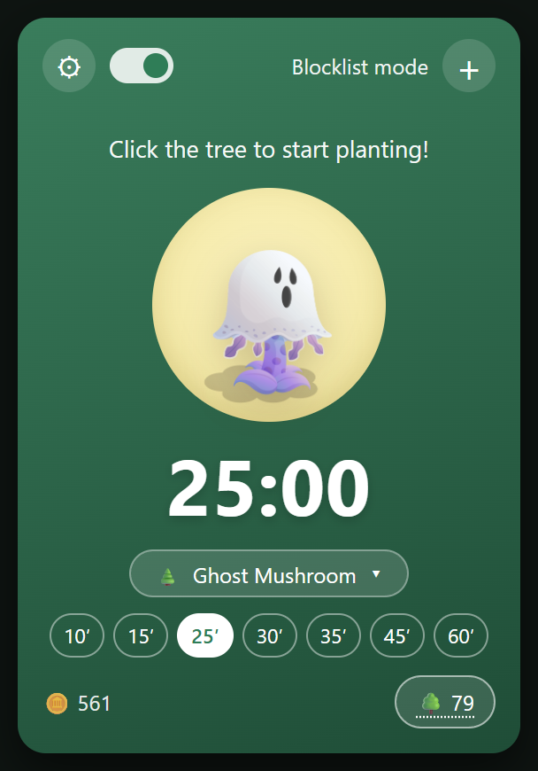
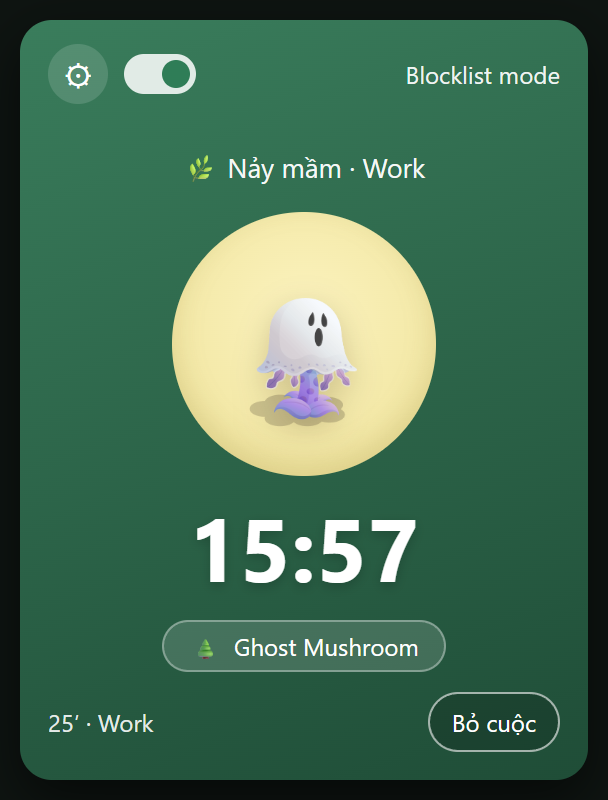
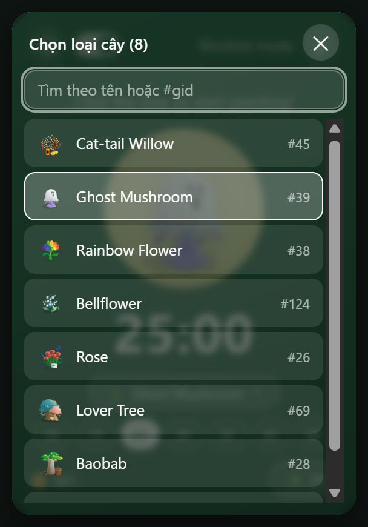
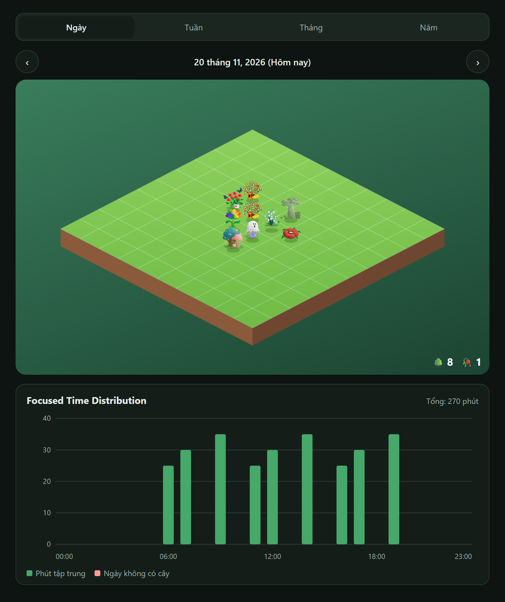
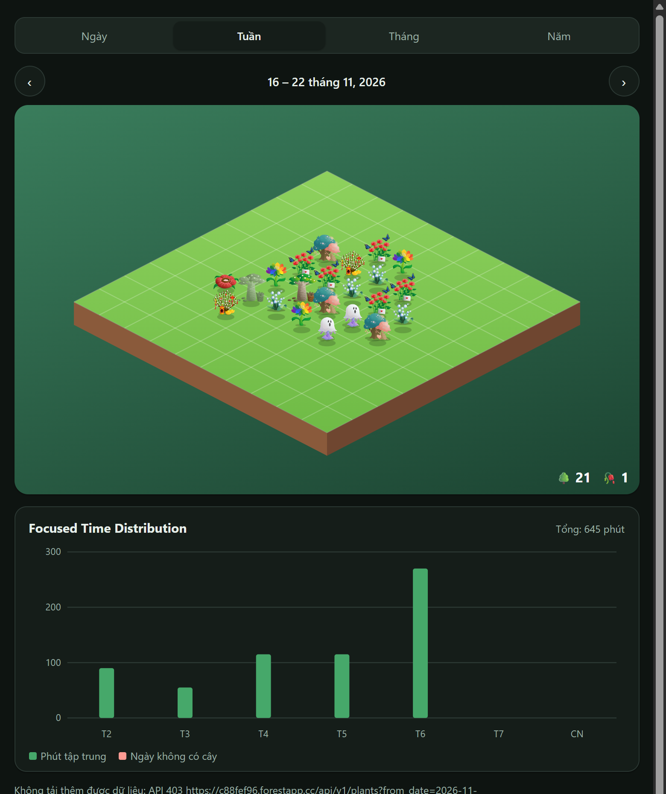
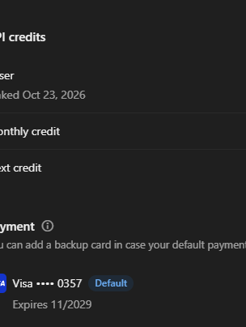
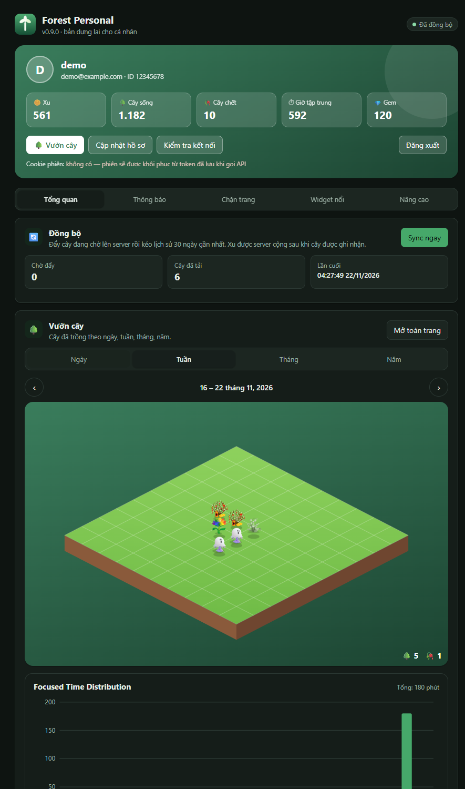
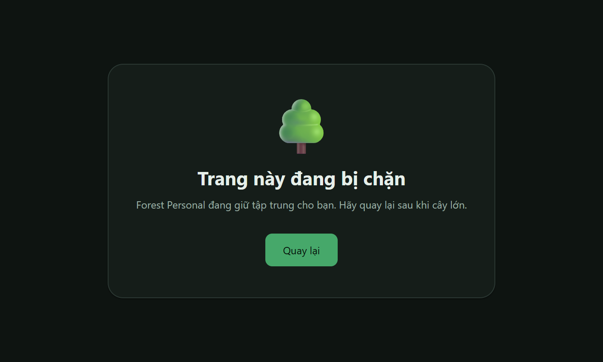

# Forest Personal

Bản dựng lại **không chính thức** của extension [Forest](https://www.forestapp.cc) (Chrome / Brave, Manifest V3) cho mục đích cá nhân: đăng nhập, trồng cây, nhận xu, xem vườn cây theo ngày/tuần/tháng/năm, chặn trang khi tập trung, widget nổi trên mọi app và **thử thách tập trung** (focus challenge).

## Tính năng

### Popup — card xanh kiểu Forest

Gear mở cài đặt, công tắc **Blocklist mode**, nút `+`, cây tròn, timer lớn, chip thời lượng 10/15/25/30/35/45/60 phút, xu và số cây sống.

| Idle | Đang trồng |
|---|---|
|  |  |

### Chọn cây (có tìm kiếm)

Danh sách loại cây đã mở khóa từ server, kèm ảnh thumbnail; tìm theo tên hoặc `#gid`, `Enter` để chọn, `Esc` để đóng.

### Vườn cây — màn Overview

Tab **Ngày / Tuần / Tháng / Năm**, mặt đất isometric đặt cây đã trồng (cây chết bị khử màu), số cây sống/chết và biểu đồ *Focused Time Distribution*. Dữ liệu các kỳ cũ được tải theo yêu cầu từ server.

| Ngày | Tuần |
|---|---|
|  |  |

### Widget nổi (always-on-top)

App WPF trong suốt luôn nổi trên các cửa sổ khác, đồng bộ với extension qua `127.0.0.1:35731`; có chọn thời lượng, Start / Give up và ảnh cây.

### Cài đặt & trang chặn

Hero hồ sơ (xu, cây sống/chết, giờ tập trung), các tab Tổng quan · Thông báo (Telegram, toast) · Chặn trang · Widget nổi · Nâng cao; tab Tổng quan nhúng sẵn Vườn cây.

Chặn trang bằng `declarativeNetRequest` (blocklist hoặc whitelist):

### Khác

- **Thông báo Telegram** qua bot của bạn (cây lớn/chết, xu, số cây trong ngày): thiết lập trong Options, có nút lấy chat ID và gửi thử.
- **Thử thách tập trung**: tab *Thử thách* ở Options liệt kê challenge đang mở + tiến độ, nút **Nhận thưởng** khi `claimable`, và danh sách vật phẩm giao hàng claim được (`delivery/items`). API trích từ APK gốc ở [`docs/CHALLENGE_API.md`](docs/CHALLENGE_API.md).
- **Sync 2 chiều**: đẩy cây đang chờ (`POST /plants`), kéo lịch sử (`GET /plants`), xu thưởng = chênh lệch coin sau khi ghi.
- **Giao diện** light/dark theo hệ thống, dùng chung design token ở `ui.css`.

## Cài đặt

> Hướng dẫn chi tiết, xử lý sự cố và phụ lục (quyền, dữ liệu, cổng mạng, FAQ, gỡ cài đặt): [`docs/INSTALL.md`](docs/INSTALL.md). Tải bản dựng sẵn ở [Releases](https://github.com/dikhamchua/forest-personal/releases).

1. Mở `brave://extensions` (hoặc `chrome://extensions`), bật **Developer mode**.
2. **Load unpacked** → chọn thư mục repo này.
3. Mở **Options**, đăng nhập bằng tài khoản Forest.

Có thể chạy song song với Forest gốc: server chỉ chấp nhận `Origin` của bản gốc nên extension tự gắn header đó bằng một rule DNR (chỉ áp cho request do chính nó phát ra).

### Widget nổi (tuỳ chọn, Windows)

1. Options → bật **Bật widget nổi trên các app khác** (Chrome sẽ hỏi quyền localhost).
2. Chạy `float\start-float.bat`.

### Auto-reload khi phát triển (tuỳ chọn)

Load unpacked `dev\reloader` một lần, rồi chạy `dev\start-reloader.bat`. Sửa file là extension tự nạp lại. Xem [`dev/README.md`](dev/README.md).

## Cấu trúc

| Đường dẫn | Vai trò |
|---|---|
| `manifest.json`, `background.js` | Service worker: state machine trồng cây, alarm, DNR, thông báo, cầu nối widget |
| `api.js`, `storage.js` | Client API Forest, schema lưu trữ, sync |
| `popup.*`, `options.*`, `garden.*`, `blocked.*`, `ui.css` | Giao diện |
| `float/` | Widget WPF + bridge HTTP |
| `dev/` | Watcher và helper reloader (chỉ cho phát triển) |
| `icons/` | Icon extension |
| `SPEC.md` | Tài liệu kỹ thuật chi tiết |

## Chưa hỗ trợ

Đăng nhập Google/Facebook (PKCE), kích hoạt boost, thành tựu. Xem mục cuối của [`SPEC.md`](SPEC.md).
